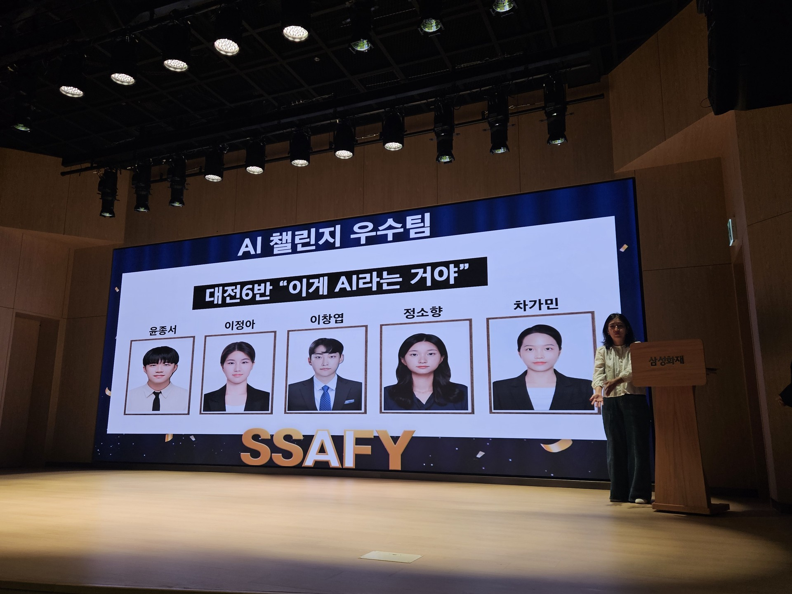
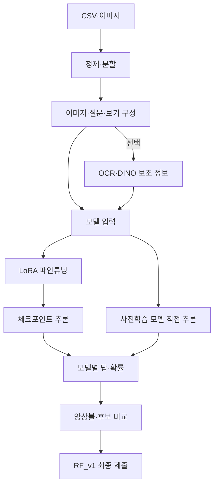
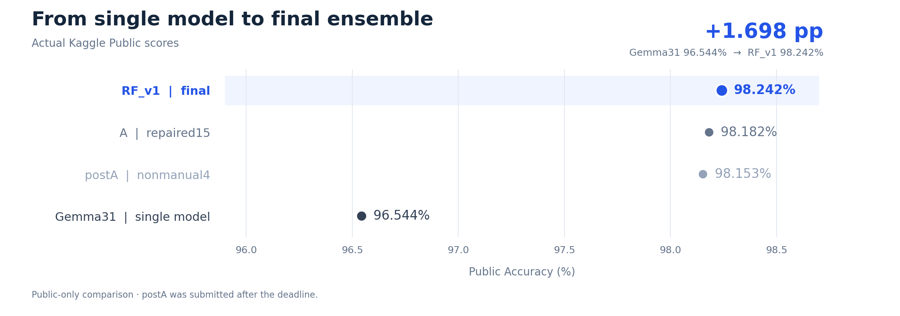

# 삼성 AI Challenge 2

**한국어 텍스트 이미지 기반 4지선다 VQA**

이미지와 한국어 질문, 네 개의 보기를 입력받아 정답 `a / b / c / d`를 예측하는 **VQA(Visual Question Answering)** 프로젝트입니다. 데이터 정제, 시각·언어 모델(VLM) 학습·추론, 보기 순서 TTA, 앙상블을 거쳐 **전국 1위·최우수상**을 달성했습니다.

| 최종 성과 | 결과 |
| --- | --- |
| 순위·수상 | **Kaggle 217팀 중 전국 1위 · 최우수상** |
| Private Accuracy | **98.331% · 0.98331** |
| Public Accuracy | **98.242% · 0.98242** |
| 최종 제출물 | [RF_v1.csv](앙상블_결과/RF_v1.csv) |
| 팀 | 대전 6반 · **B061_자 이게 AI라는 거야** |

전체 참가 규모는 219팀, Kaggle 최종 리더보드 표시 규모는 217팀입니다.

<p align="center">
  
</p>

**팀원:** 윤종서 · 이정아 · 이창엽 · 정소향 · 차가민

[프로젝트 개요](#1-프로젝트-개요) · [모델 파이프라인](#2-모델-파이프라인) · [데이터·평가](#3-데이터와-평가) · [모델 비교](#4-모델-비교) · [앙상블](#5-앙상블) · [실행 방법](#7-실행-방법)

## 1. 프로젝트 개요

| 항목 | 내용 |
| --- | --- |
| 대회 | SSAFY 16기 2회차 AI 챌린지 |
| 기간 | 2026.09.14 ~ 2026.09.28 · 수상 2026.10.08 |
| 문제 | 텍스트가 포함된 이미지를 이해하고 한국어 질문에 답하는 VQA |
| 입력 → 출력 | 이미지 + 질문 + 보기 4개 → 정답 글자 1개 |
| 평가 | Accuracy · Public/Private은 테스트의 서로 다른 약 50% |
| 제출 | 6,714문항 · `id,answer` CSV |

**대회 문항 예시**

| 입력 | 내용 |
| --- | --- |
| 이미지 | 목적지를 안내하는 표지판 사진 |
| 질문 | 표지판은 어디로 향하는 길을 안내하고 있나요? |
| 보기 | a. 역삼 · b. 선릉 · c. 사상 · d. 강남 |
| 정답 | **c** |

## 2. 모델 파이프라인



| 단계 | 처리 내용 |
| --- | --- |
| 환경·설정 | GPU·CUDA 확인, 모델별 라이브러리 설치, 데이터·모델·출력 경로 설정 |
| 데이터 정제 | CSV 형식 통일, 이미지 경로·보기·정답 검사, 라벨 출처 기록 |
| 데이터 분할 | 이미지 해시로 그룹을 묶어 학습/검증 분리, 분할 목록 고정 |
| 입력 구성 | RGB 변환, 모델별 이미지 processor, 질문·보기·출력 지시와 채팅 템플릿 적용 |
| OCR/DINO · 선택 | OCR 문자와 객체 정보를 추출해 모델 입력에 보조 정보로 추가 |
| 파인튜닝 | LoRA로 모델을 학습하고 adapter·설정·체크포인트 저장 |
| 추론 | 생성 답 파싱 또는 Direct Choice Logit으로 정답 선택, 실패·재시도 기록 |
| 평가·저장 | validation 정확도 측정, 모델별 제출 CSV와 확보된 실제 확률 저장 |
| 앙상블 | ID·보기 순서를 맞춰 모델 결과 결합, 최종 후보 비교 |

**‘깡’ 실행**은 추가 학습 없이 사전학습 모델을 바로 추론하는 경로입니다. **LoRA 파인튜닝**은 적은 수의 추가 가중치(adapter)를 대회 데이터로 학습하고, 추론할 때 원본 모델과 함께 적용하는 경로입니다.

### OCR/DINO와 보기 TTA

**OCR**는 이미지 속 문자를 읽고, **Grounding DINO**는 객체 정보를 추출합니다. 결과는 질문과 함께 보조 입력으로 사용합니다. Qwen27에서는 이를 적용한 Hybrid와 모델 단독 입력인 Only를 비교했습니다.

**Direct Choice Logit**은 모델이 답할 위치의 a/b/c/d 토큰 점수를 직접 읽는 방식입니다. **Softmax**로 네 점수를 합이 1인 확률 분포로 변환합니다.

Agnes는 **1024 해상도와 보기 shift 0/1/2/3**을 사용합니다. 각 shift에서 답 토큰의 logits에 Softmax를 적용하고, 확률을 **원래 보기 순서로 복원한 뒤 평균**합니다.

아래는 shift 0과 2를 사용한 설명용 예시입니다. 대문자 A/B/C/D는 원래 보기의 내용을 뜻합니다.

| 처리 | 보기 순서 | 해당 순서의 확률 |
| --- | --- | --- |
| shift 0 추론 | A · B · C · D | 0.10 · 0.20 · 0.60 · 0.10 |
| shift 2 추론 | C · D · A · B | 0.70 · 0.10 · 0.05 · 0.15 |
| shift 2 순서 복원 | A · B · C · D | 0.05 · 0.15 · 0.70 · 0.10 |
| 확률 평균 | A · B · C · D | 0.075 · 0.175 · **0.650** · 0.100 |

최종 선택은 **c**입니다. 보기 TTA는 같은 모델을 여러 보기 순서로 추론하는 방법이며, 모델 간 앙상블과 구분합니다.

## 3. 데이터와 평가

공통 입력 열은 `id, path, question, a, b, c, d`, 정답 열은 `answer`입니다. `path`를 데이터 루트와 결합해 이미지를 읽습니다.

| 데이터 | 문항 수 | 용도 |
| --- | ---: | --- |
| clean7169 정제본 | 7,169 | 기존 공통 학습·검증 데이터 |
| 고정 학습 분할 | 5,735 | 모델 학습 |
| 고정 validation | 1,434 | 동일 분할을 사용하는 실험 비교 |
| 다른 validation | 672 / 1,343 등 | 과거 개별 실험 평가 |
| RF 교차 검증 | 1,096 | 공통 공식 정답 문항으로 RF 평가 |
| test | 6,714 | 제출 예측 |

정제본에는 **train 원본 정답과 dev pseudo-label**이 포함됩니다. Gemma31 validation 1,434개는 원본 정답 출처 1,123개와 dev 출처 311개로 구성됩니다.

| 대표 실행 | validation 문항 수 | 정답 수 | Accuracy |
| --- | ---: | ---: | ---: |
| Qwen3-VL 4B | 1,343 | 1,284 | 95.6069% |
| Qwen3-VL 8B | 1,434 | 1,364 | 95.1185% |
| Gemma26 | 1,343 | 1,301 | 96.8727% |
| Gemma31 | 1,434 | 1,400 | **97.6290%** |

실험 비교 기준은 **동일한 문항 ID·보기·정답·분할 목록**입니다. validation 수치와 Public/Private 점수는 각각의 평가 집합으로 구분합니다.

## 4. 모델 비교

| 담당 | 모델·실험 | 실행 방식 | Public | 코드·결과 |
| --- | --- | --- | ---: | --- |
| 창엽 | Qwen3.8-27B + OCR/DINO | GPTQ 4bit + LoRA + 보조 정보 | 0.95918 | [Hybrid](창엽/Qwen3.8-27B_OCR-DINO/) |
| 창엽 | Qwen3.8-27B Only | GPTQ 4bit + LoRA | 0.95621 | [Only](창엽/Qwen3.8-27B_Only/) |
| 창엽 | Qwen3.5-122B-A10B-GPTQ-Int4 | 깡 · vLLM | 0.96097 | [Qwen122](창엽/Qwen3.5-122B-A10B-GPTQ-Int4/) |
| 창엽 | Agnes-3.0-Flash | BF16 LoRA · 1024 · 4-way TTA | 0.96157 | [Agnes](창엽/Agnes-3.0-Flash/) |
| 창엽 | GLM-4.6V AWQ 4bit | 깡 · vLLM | 0.78194 | [GLM](창엽/GLM-4.6V_AWQ-4bit/) |
| 창엽 | Ling-3.0-flash | 깡 · INT4 · Ling vLLM fork | 0.94638 | [Ling](창엽/Ling-3.0-flash/) |
| 종서 | Qwen3-VL-4B-Instruct | BF16 LoRA | 0.94399 | [Qwen3-VL 4B](종서/Qwen3-VL-4B-Instruct/) |
| 종서 | Qwen3-VL-8B-Instruct | BF16 LoRA | 0.95174 | [Qwen3-VL 8B](종서/Qwen3-VL-8B-Instruct/) |
| 종서 | Gemma-4-26B-A4B-it | BF16 LoRA | 0.96216 | [Gemma26](종서/Gemma-4-26B-A4B-it/) |
| 종서 | **Gemma-4-31B-it** | **BF16 LoRA** | **0.96544** | [Gemma31](종서/Gemma-4-31B-it/) |
| 종서 | Qwen2.5-VL-7B-Instruct | LoRA 코드 보관 · 성적 run 미확인 | 0.89603 | [Qwen2.5-VL](종서/Qwen2.5-VL-7B-Instruct/) |

Public은 대회 공유 기록, 실행 방식은 보관 코드 기준입니다. Qwen27의 정확한 성적 run 대응은 추가 확인 대상입니다. 모델 ID·노트북·제출 파일은 [파일 대응표](파일_대응표.csv)에 정리돼 있습니다.

단일 최고 모델인 **Gemma31**의 대표 실행은 `google/gemma-4-31B-it`, BF16, LoRA `r=8 / alpha=16`, 학습률 `1e-4`, 1 epoch입니다. [실행 설정](종서/Gemma-4-31B-it/대표_실행/config.json)과 [평가 로그](종서/Gemma-4-31B-it/대표_실행/after_metrics.json)를 함께 제공합니다.

## 5. 앙상블

모델별 예측을 같은 ID와 클래스 순서 `[a,b,c,d]`로 정렬한 뒤 결합합니다.

| 방법 | 결합 방식 |
| --- | --- |
| Hard 투표 | 모델의 정답 글자 결합 · 다수결, 4/8모델 만장일치, core 모델 합의 |
| Soft 결합 | 실제 모델 확률의 평균·가중 결합 |
| Random Forest | 보기별 지지, 득표 차이, 의견 분산, 질문 유형으로 후보 정답 여부 학습 |
| 검토·보정 | 불일치 문항 검토, 기존 제출물과 수정 후보 비교 |

기존 RF는 문항마다 a/b/c/d 후보를 펼쳐 각 후보가 정답인지 학습합니다. 이미지 해시 기반 5-fold로 검증하며, 같은 문항의 네 후보는 같은 fold에 배치합니다. **RF_v1은 RF 예측에 보조 추정과 기존 제출 점수 조건을 결합한 제출물**입니다.

Soft 원본은 `qwen27_new`·Agnes의 validation/test와 `qwen_og`의 test에서 확보됐습니다. Hard 답을 one-hot으로 만든 값은 투표 특징으로 사용하며, 실제 Soft 확률과 구분합니다.

### 최종 후보 비교

| 제출물 | 변경 내용 | Public | Private |
| --- | --- | ---: | ---: |
| **[RF_v1.csv](앙상블_결과/RF_v1.csv)** | **최종 선택** | **0.98242** | **0.98331** |
| [A: repaired15](앙상블_결과/submission_guard_A_RF_repaired15.csv) | RF_v1에서 15개 답 수정 | 0.98182 | 0.98302 |
| postA: nonmanual4 | A에서 4개 추가 수정 · 마감 후 제출 | 0.98153 | 0.98272 |

RF_v1이 최종 후보 중 가장 높은 Private 점수를 기록했습니다. Public은 단일 최고 Gemma31의 **96.544% → 98.242%**, **+1.698%p** 향상됐습니다.



[최종 제출 화면·수상 근거](docs/EXPERIMENT_DETAILS.md#1-최종-성과와-제출물) · [RF 원본 코드와 실행 기록](<공통/B061_자_이게_AI라는거야_solution/B061_자 이게 AI라는 거야_solution/ensemble_rf/>) · [확률 원본 상태](앙상블_결과/확률_원본_상태.md)

## 6. 저장소 구성

| 위치 | 내용 |
| --- | --- |
| [공통/](공통/) | 팀 공통 베이스라인, 정제 CSV, solution 패키지, 데이터 위치 |
| [창엽/](창엽/) | Qwen27 Hybrid/Only, Qwen122, Agnes, GLM, Ling |
| [종서/](종서/) | Qwen3-VL 4B/8B, Gemma26/31, Qwen2.5-VL, 대표 실행 |
| [앙상블_결과/](앙상블_결과/) | RF_v1·A CSV, 만장일치 결과, 수동 검토·감사 기록 |
| [발표자료/](발표자료/) | 대회 발표 PDF와 설계 자료 |
| [baseline_v2+ensemble_v1/](baseline_v2+ensemble_v1/) | 재사용 모델·앙상블 노트북, 설정, 체크리스트, PPT |
| [파일_대응표.csv](파일_대응표.csv) | 모델 ID·성적·노트북·제출 CSV 연결 |
| [docs/EXPERIMENT_DETAILS.md](docs/EXPERIMENT_DETAILS.md) | 모델 환경·학습 설정·평가 범위·재현 조건 |

## 7. 실행 방법

```bash
git clone https://github.com/changyoupkkun99/AI_Challenge_2.git
cd AI_Challenge_2
```

1. [데이터 위치](공통/데이터_위치.md)에서 원본 이미지와 정제 데이터·분할 목록을 준비합니다.
2. 실행할 모델 폴더의 `README.md`, `env.md`, `requirements.txt`에 따라 환경을 구성합니다.
3. 노트북에서 데이터·모델·출력 경로를 설정합니다.
4. 대표 실행의 config·adapter·분할·프롬프트·추론 설정을 적용합니다.
5. 소량 실행으로 이미지 로드와 학습·추론을 점검한 뒤 전체 실행합니다.
6. 제출 CSV의 6,714개 ID, 원본 순서, 중복, `a/b/c/d` 값을 검사합니다.

Qwen122·Ling은 모델별 vLLM 환경을 사용합니다. 원본 Gemma31 노트북의 설정 셀 수정 사항은 [재현 조건](docs/EXPERIMENT_DETAILS.md#6-재현-조건)에 정리했습니다.

## 8. 재사용 베이스라인

대회 이후 새 VQA 프로젝트에 적용할 수 있도록 **단일 모델 학습**과 **앙상블**을 별도 노트북으로 구성했습니다.

| 노트북 | 실행 모드 |
| --- | --- |
| [모델 베이스](baseline_v2+ensemble_v1/VQA_Gemma31B_Reusable_Baseline_v1.ipynb) | `prepare` 데이터 점검 → `smoke` 소량 실행 → `full` 학습 / `infer` adapter 추론 |
| [앙상블 베이스](baseline_v2+ensemble_v1/VQA_Ensemble_Baseline_v1.ipynb) | `inspect` 결과 검사 → `evaluate` 후보 평가 → `export` 제출 저장 |

### 모델 초기 설정

| 항목 | 설정 |
| --- | --- |
| 모델 | `unsloth/gemma-4-31B-it-unsloth-bnb-4bit` |
| LoRA | r=16 · alpha=32 · language attention + MLP · vision 고정 |
| 학습 | 외부 MTVQA KO·KRETA → 내부 정제 데이터 · 각 1 epoch |
| Loss | 정답 글자 1토큰 위치에 Cross-Entropy |
| 프롬프트 | 질문·보기·출력 지시 2회 반복 |
| 분할 | 이미지 그룹을 고려한 약 4:1 · 학습 보기 재배치로 정답 위치 약 25%씩 배정 |
| 증강 | 원본 + JPEG quality 70 + blur + affine |
| 추론 | Direct Choice Logit → Softmax → shift 0/2 확률 평균 |
| 선택 기능 | OCR/DINO, 1024 비율 유지 padding, 4-way TTA, 어려운 문항 보기 반전 |

Public 0.97229 공개 솔루션을 참고한 후속 구성입니다. 검증 상태는 **CPU 코드·데이터 처리 점검 완료, 전체 GPU 학습·추론 성적 미측정**입니다. 세부 초기값과 적용 근거는 [Reference Integration](baseline_v2+ensemble_v1/VQA_Reference_Integration.md)에 정리했습니다.

### 결과 저장

| 파일 | 내용 |
| --- | --- |
| `probs/valid_logits.npy`, `probs/test_logits.npy` | 원래 보기 순서로 복원한 reference shift 0 logits · `(N,4)` |
| `probs/valid_probs.npy`, `probs/test_probs.npy` | 보기 순서를 복원한 TTA 평균 확률 · `(N,4)` |
| `probs/valid_ids.json`, `probs/test_ids.json` | 예측 행의 ID 순서 |
| `probs/valid_labels.npy` | validation 정답 · a/b/c/d = 0/1/2/3 |
| `validation_predictions.csv`, `validation_summary.json` | 문항별 예측과 평가 지표 |
| `probs/probability_metadata.json`, `analysis/` | 모델·분할·클래스 순서·shift·집계 방식 |

이 저장 규격은 후속 베이스에 적용됩니다. 평균 확률과 reference logits를 분리해 이후 Soft 앙상블에서 재사용합니다.

## 9. 상세 문서

| 자료 | 내용 |
| --- | --- |
| [실험 상세](docs/EXPERIMENT_DETAILS.md) | 성과 근거, 모델 ID·환경, 실제 학습 설정, 데이터 분할, RF, 재현 조건 |
| [24단계 체크리스트](baseline_v2+ensemble_v1/VQA_Baseline_Checklist.md) | 환경 준비부터 학습·추론·제출 검증까지 |
| [모델 코드 설명](baseline_v2+ensemble_v1/VQA_Model_Pipeline_Code_Guide.md) · [모델 PPT](baseline_v2+ensemble_v1/VQA_Model_Pipeline_Explained.pptx) | 파인튜닝 단계와 별첨의 깡 모델 실행 |
| [앙상블 코드 설명](baseline_v2+ensemble_v1/VQA_Ensemble_Pipeline_Code_Guide.md) · [앙상블 PPT](baseline_v2+ensemble_v1/VQA_Ensemble_Pipeline_Explained_r2.pptx) | Hard/Soft 결합, RF, 메타 검증, 제출 저장 |
| [Python 설정](baseline_v2+ensemble_v1/VQA_Baseline_Config.py) · [JSON 설정](baseline_v2+ensemble_v1/VQA_Default_Config.json) | 초기 프리셋과 모델 선택 프로필 |
