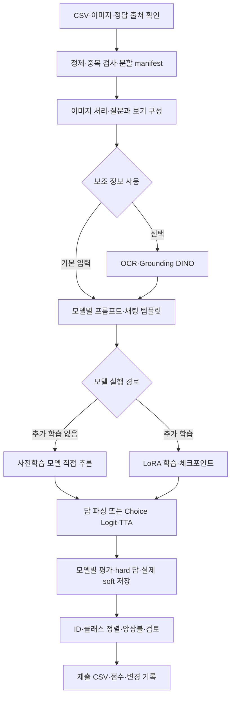

# SSAFY 16기 AI Challenge 2 · 텍스트 이미지 VQA

> 🏆 **전국 1위 · SSAFY 16기 2회차 AI 챌린지 최우수상**

한국어 질문과 이미지, 네 개의 보기를 함께 이해하고 **a / b / c / d 중 하나를 선택하는 멀티모달 VQA 프로젝트**입니다. 데이터 정제와 평가 집합 관리부터 사전학습 모델의 직접 추론, LoRA 파인튜닝, 보기 순서 TTA, 모델별 결과 저장, 앙상블과 제출물 검증까지의 실험을 정리했습니다.

팀 **‘자 이게 AI라는 거야’**는 최종 선택 제출물 **`RF_v1.csv`**로 **Private 0.98331, Public 0.98242**를 기록하며 전국 1위를 달성했습니다. 이 저장소는 대회 실험 자료와, 대회 이후 비슷한 VQA 프로젝트에서 사용할 수 있도록 정리한 **재사용 모델·앙상블 베이스라인**을 함께 보관합니다.

| 항목 | 최종 결과 |
| --- | --- |
| **최종 성과** | **Kaggle 리더보드 217팀 중 전국 1위** |
| 참가 규모 | 전체 참가 219팀 · Kaggle 리더보드 표시 217팀 |
| **Private** | **0.98331 · Accuracy 98.331% · 최종 1위** |
| **Public** | **0.98242 · Accuracy 98.242% · 1위** |
| 성적을 낸 선택 제출물 | [RF_v1.csv](앙상블_결과/RF_v1.csv) |
| 수상 | 최우수상 · 2026.10.08 |
| 팀 | 대전 6반 · B061_자 이게 AI라는 거야 |

전체 참가 219팀은 팀에서 제공한 참가 규모이며, Kaggle 화면에는 마지막 순위가 217위로 표시됩니다. 두 집계의 차이가 생긴 이유는 미확인입니다. 순위와 점수는 아래 최종 리더보드·제출 내역 화면을 기준으로 기록합니다.

팀원: **윤종서 · 이정아 · 이창엽 · 정소향 · 차가민**

<p align="center">
  
</p>

<details>
<summary><strong>최종 성과 근거 보기 — 리더보드·제출 내역·수상 사진</strong></summary>

**Private 최종 리더보드:** 1위, 0.98331


**Public 리더보드:** 1위, 최고 점수 0.98242


**제출 내역:** `RF_v1.csv`의 Private 0.98331 / Public 0.98242와 선택 상태, A 및 후속 후보의 개별 성적


**Kaggle 표시 규모:** 제공된 리더보드 하단의 마지막 순위 217위


**최우수상 트로피:** 이창엽, 16기 AI 챌린지, 2026.10.08

<p align="center">
  
</p>

</details>

**바로 보기:** [대회와 데이터](#1-대회와-데이터) · [전체 파이프라인](#2-전체-파이프라인) · [모델별 성적](#4-모델별-public-성적) · [앙상블 결과](#5-앙상블과-확인된-제출-결과) · [실행 안내](#7-실행-안내) · [공부하는 순서](#9-공부하는-순서)

## 1. 대회와 데이터

| 항목 | 내용 |
| --- | --- |
| 대회 | SSAFY 16기 2회차 AI 챌린지 |
| 주제 | 텍스트 이미지 기반 질의응답 모델 개발 |
| 대회 기간 | 2026.09.14 ~ 2026.09.28 · 제공된 Overview 기준 |
| 입력 | 이미지 + 한국어 질문 + 보기 a/b/c/d |
| 출력 | a/b/c/d 중 한 글자 |
| 리더보드 지표 | Accuracy |
| 테스트 제출 | 6,714문항, `id,answer` CSV |
| 테스트 평가 구간 | Public / Private이 서로 다른 약 50% 구간 |
| 대회 평가 안내 | 모델 정확도·재현성·효율성, Discussion 활동, 발표 평가 |
| 최종 리더보드 | 전국 1위 · Private 0.98331 / Public 0.98242 |
| 수상 결과 | 대전 6반 ‘이게 AI라는 거야’ 최우수상 · 2026.10.08 |

예를 들어 표지판 사진과 “표지판은 어디로 향하는 길을 안내하고 있나요?”라는 질문에, 보기 **a. 역삼 / b. 선릉 / c. 사상 / d. 강남**이 주어지면 모델은 정답 글자 **c**를 출력합니다. 이 예시는 대회 개요에 제시된 문항입니다.

### 데이터 연결과 평가 집합

공통 코드에서 추론에 전달하는 열은 `id, path, question, a, b, c, d`입니다. `path`를 데이터 루트와 결합해 이미지를 열고, 학습·평가에서는 별도의 `answer`를 사용합니다. 정답이나 정답 출처를 추론 프롬프트에 넣지 않습니다.

| 구분 | 확인된 범위 | 해석 |
| --- | --- | --- |
| clean7169 정제본 | 7,169문항 | 대표 Gemma31 실행 기록에 train 출처 5,527개 + dev 출처 1,642개로 기록 |
| clean7169 고정 학습 | 5,735문항 | 기존 정제본 manifest의 학습 부분 |
| clean7169 고정 validation | 1,434문항 | 같은 manifest를 사용하는 실행끼리 비교 |
| 다른 과거 validation | 672개·1,343개 등 | 1,434개와 다른 평가 집합. 별도 실행으로 기록 |
| RF 학습·교차 검증 | 공식 정답과 연결된 공통 1,096문항 | 기존 RF 자료의 범위. 전체 1,434개 validation과 구분 |
| test | 6,714문항 | 학습에 넣지 않고 제출 예측에 사용 |
| 재사용 베이스의 분할 | 이미지 그룹을 고려한 약 4:1 | 새 프로젝트에서 생성·고정하는 manifest. 기존 5,735/1,434를 강제하지 않음 |

**dev 출처 라벨은 공식 정답과 구분합니다.** 대표 실행의 기록에는 dev 라벨이 AI 시각 판단 기반 pseudo-label이라고 명시되어 있습니다. 예를 들어 Gemma31의 1,434개 validation은 train 원본 출처 1,123개와 dev pseudo-label 출처 311개가 섞인 평가입니다.

분할 시 이미지 파일의 SHA-256을 활용해 동일 파일이 학습·검증 양쪽에 들어가는지 확인합니다. 바이트가 다른 재압축·크롭 이미지까지 동일 이미지로 판별했다는 의미는 아닙니다.

> **4:1 분할과 정답 위치 25%는 다른 설정입니다.** 재사용 베이스는 학습/검증을 약 80:20으로 나누고, 학습용 보기 재배치로 정답 위치를 a/b/c/d에 균등 배정합니다. 원본 정답 분포를 유지하는 분할만으로 각 위치가 25%가 되지는 않습니다. validation/test는 원래 보기 순서를 기준으로 평가합니다.

원본 이미지와 데이터 아카이브 위치는 [공통/데이터_위치.md](공통/데이터_위치.md)를 참고하세요. 이 저장소의 정제 CSV만으로 전체 GPU 학습을 실행할 수는 없습니다.

## 2. 전체 파이프라인



OCR/DINO는 해당 실험에서만 사용하는 선택 가지입니다. 양자화 여부와 파인튜닝 여부도 독립적입니다. **4bit 모델을 불러왔다는 이유만으로 추가 학습이 없는 모델이라고 분류하지 않습니다.**

프로젝트에서 말하는 **‘깡’ 실행**은 추가 파인튜닝 없이 사전학습 모델에 이미지와 프롬프트를 넣어 바로 추론하는 경로를 뜻합니다.

## 3. 모델 실행에서 확인한 핵심 구성

| 단계 | 구성과 확인할 내용 |
| --- | --- |
| 환경 준비 | GPU·VRAM·CUDA 확인, 모델별 라이브러리 설치, 모델 접근 권한 및 revision 기록 |
| 데이터 준비 | CSV 열·ID·이미지 경로·보기·정답 검사, 정제 기록과 라벨 출처 보존 |
| 분할 | 이미지 중복 검사, 학습/검증 manifest 고정, 실험별 평가 집합 구분 |
| 이미지 처리 | RGB 변환, 모델별 processor, 비율 유지 처리와 해상도 선택 |
| 선택 보조 정보 | OCR 텍스트와 DINO 객체 정보를 구성하고 캐시 사용 |
| 프롬프트 | 질문·보기·출력 형식, 모델별 채팅 템플릿과 답 위치 확인 |
| 모델 로드 | BF16 또는 GPTQ/AWQ/BNB 등 양자화 경로를 모델별로 선택 |
| 파인튜닝 | LoRA 대상 모듈, 학습률·epoch·batch·누적 배치, 답 토큰 loss, 체크포인트 기록 |
| 직접 추론 | 사전학습 가중치를 그대로 사용, 생성 답 파싱·실패 기록·재시도 또는 이어 실행 |
| Choice Logit | 다음 답 위치의 a/b/c/d 토큰 logits를 추출하고 네 값에 Softmax 적용 |
| Option Permutation | 보기 순서를 바꿔 추론한 결과를 원래 선택지 순서로 복원 |
| TTA | 같은 모델의 여러 추론 확률을 복원 후 평균. 모델 간 앙상블과 구분 |
| 평가·차트 | 정확도, 실행 시간·메모리·실패 건수, 실제 실행 결과 비교 |
| 결과 저장 | 제출 CSV, 실제 logits/probs, IDs·labels·설정·메타데이터·감사 기록 |

### OCR/DINO와 모델 단독 경로

- **Hybrid Qwen27:** EasyOCR와 Grounding DINO의 보조 정보를 사용하는 실험, GPTQ 4bit 모델과 LoRA 코드가 포함되어 있습니다.
- **Qwen27 Only:** OCR/DINO를 사용하지 않는 clean7169 경로입니다. 보관된 노트북은 **GPTQ 4bit + attention LoRA 학습**을 구현합니다. 이름의 Only는 추가 학습이 없다는 뜻이 아닙니다.
- **Qwen122 / GLM / Ling:** 보관된 대표 노트북은 vLLM 기반의 추가 학습 없는 추론 경로입니다.
- **Agnes / Qwen3-VL / Gemma:** LoRA 학습 경로와 평가·제출 결과를 정리했습니다.

OCR/DINO의 이득은 모델과 입력 구성에 따라 달라질 수 있습니다. Qwen27의 두 Public 기록만으로 다른 모든 설정이 같은 통제 실험을 수행했다고 주장하지 않으며, 새 실험에서는 동일 validation을 사용해 기능을 하나씩 비교합니다.

### Agnes의 1024 + 4-way TTA

Agnes 노트북에는 고해상도 1024 경로와 **보기 순서 shift 0/1/2/3**이 있습니다. 이때 shift는 보기의 순환 이동입니다.

| shift | 입력에 놓는 원래 보기 순서 |
| --- | --- |
| 0 | a, b, c, d |
| 1 | b, c, d, a |
| 2 | c, d, a, b |
| 3 | d, a, b, c |

각 입력에서 a/b/c/d 위치의 확률을 구하고, **원래 보기 a/b/c/d에 해당하는 열로 복원한 뒤 확률을 평균**합니다. 복원하지 않은 확률을 평균하면 서로 다른 보기의 점수를 섞게 됩니다.

### 실제 Gemma31 실행과 이후 참고 설정

| 항목 | 대회 Gemma31 대표 실행 | 이후 재사용 베이스의 참고 프리셋 |
| --- | --- | --- |
| 모델 | `google/gemma-4-31B-it` | `unsloth/gemma-4-31B-it-unsloth-bnb-4bit` |
| 가중치 형식 | BF16, 비양자화 | bitsandbytes 4bit |
| LoRA | r=8, alpha=16 | r=16, alpha=32, language attention + MLP |
| 학습률 | 1e-4 · 저장된 실행 설정 기준 | 외부·내부 단계 각각 1e-4 |
| epoch | 1 | 외부·내부 단계 각각 1 |
| GPU | RTX PRO 6000 Blackwell Server Edition · 평가 로그 기준 | 하드웨어 프로필 선택, 새 베이스 전체 GPU 학습 미실행 |
| validation | 1,400/1,434 · 97.6290% | 새 manifest로 측정할 대상, 성적 미확인 |
| Public | 0.96544 | 성적 미확인 |

대회 대표 실행의 설정은 [config.json](종서/Gemma-4-31B-it/대표_실행/config.json), 평가 결과는 [after_metrics.json](종서/Gemma-4-31B-it/대표_실행/after_metrics.json)에 있습니다. 노트북의 현재 기본값과 실제 성적을 낸 실행 설정이 다르면 **저장된 실행 기록을 우선**합니다.

## 4. 모델별 Public 성적

아래 점수는 정리된 리더보드 공유 기록입니다. **validation 정확도나 Private 성적과 같은 지표로 비교하지 않습니다.** 실행 방식 열은 보관된 노트북·대표 실행에서 확인한 경로이며, 점수와 특정 run의 직접 연결이 미확인인 경우에는 별도 표시했습니다.

| 담당 | 모델·실험 | 보관 코드의 경로 | Public | 실행 자료 |
| --- | --- | --- | ---: | --- |
| 창엽 | Qwen3.8-27B + OCR/DINO | GPTQ 4bit + LoRA + 보조 정보¹ | 0.95918 | [Qwen27 Hybrid](창엽/Qwen3.8-27B_OCR-DINO/) |
| 창엽 | Qwen3.8-27B Only | GPTQ 4bit + LoRA, 보조 정보 없음¹ | 0.95621 | [Qwen27 Only](창엽/Qwen3.8-27B_Only/) |
| 창엽 | Qwen3.5-122B-A10B-GPTQ-Int4 | 깡 · vLLM | 0.96097 | [Qwen122](창엽/Qwen3.5-122B-A10B-GPTQ-Int4/) |
| 창엽 | Agnes-3.0-Flash | BF16 LoRA, 1024·보기 TTA 실험 | 0.96157 | [Agnes](창엽/Agnes-3.0-Flash/) |
| 창엽 | GLM-4.6V AWQ 4bit | 깡 · vLLM | 0.78194 | [GLM](창엽/GLM-4.6V_AWQ-4bit/) |
| 창엽 | Ling-3.0-flash | 깡 · INT4 · Ling vLLM fork | 0.94638 | [Ling](창엽/Ling-3.0-flash/) |
| 종서 | Qwen3-VL-4B-Instruct | BF16 LoRA | 0.94399 | [Qwen3-VL 4B](종서/Qwen3-VL-4B-Instruct/) |
| 종서 | Qwen3-VL-8B-Instruct | BF16 LoRA | 0.95174 | [Qwen3-VL 8B](종서/Qwen3-VL-8B-Instruct/) |
| 종서 | Gemma-4-26B-A4B-it | BF16 LoRA | 0.96216 | [Gemma26](종서/Gemma-4-26B-A4B-it/) |
| 종서 | **Gemma-4-31B-it** | **BF16 LoRA** | **0.96544** | [Gemma31](종서/Gemma-4-31B-it/) |
| 종서 | Qwen2.5-VL-7B-Instruct | LoRA 셀 포함, 성적 실행 미확인 | 0.89603 | [Qwen2.5-VL](종서/Qwen2.5-VL-7B-Instruct/) |

¹ Hybrid 노트북에는 여러 실험 섹션이 섞여 있고, Only의 제출 파일명만으로는 특정 성적 실행을 확정할 수 없습니다. 정확한 checkpoint·선택한 셀·추론 설정과 점수의 대응은 원본 run을 추가 대조해야 합니다.

모델 ID·노트북·제출 CSV의 연결은 [파일_대응표.csv](파일_대응표.csv)에 있습니다. 예를 들어 Qwen27의 실행 모델 ID는 `btbtyler09/Qwen3.8-27B-GPTQ-4bit`이고, Gemma31의 실행 ID는 `google/gemma-4-31B-it`입니다. Gemma31을 26B의 A4B 표기와 혼동하지 않습니다.

대표 실행의 validation은 별도 표로 기록합니다.

| 대표 실행 | 평가 문항 수 | 정답 수 | validation 정확도 |
| --- | ---: | ---: | ---: |
| Qwen3-VL 4B | 1,343 | 1,284 | 95.6069% |
| Qwen3-VL 8B | 1,434 | 1,364 | 95.1185% |
| Gemma26 | 1,343 | 1,301 | 96.8727% |
| Gemma31 | 1,434 | 1,400 | 97.6290% |

같은 문항 수만으로 같은 평가 집합이라고 판단하지 않습니다. ID·이미지·보기·정답 출처와 manifest가 일치하는지 먼저 확인합니다. Qwen8B의 별도 공유 수치 97.5957%는 다른 실행의 train 원본 출처 부분 평가이며, 위 전체 validation과 다릅니다.

## 5. 앙상블과 확인된 제출 결과

### 발전 과정

1. **강한 단일 모델을 기준으로 비교:** Gemma31의 답을 기준으로 모델 간 불일치를 확인했습니다.
2. **Hard 결합 실험:** 다수결, 선택한 4/8모델의 만장일치, core 모델 합의와 가중 결합을 비교했습니다.
3. **Soft 결합 실험:** 실제 확률이 있는 모델만 대상으로 ID와 클래스 열 순서를 맞춰 확률을 결합했습니다.
4. **RF_v1:** 모델별 보기 지지와 질문 특징을 학습한 RF 추정에 보조 추정·기존 제출 점수 조건을 결합한 기록이 있습니다.
5. **검토와 보정:** 수동 검토 18문항의 자료를 보존하고, RF_v1에서 15개 답을 변경한 A를 만들었습니다.
6. **후속 후보 비교:** B 예비안과 A에서 4개를 추가 변경한 후보를 별도로 기록했습니다.
7. **최종 성적 확인:** 최종 리더보드와 제출 내역에서 RF_v1의 Private 0.98331 / Public 0.98242를 확인했습니다. A와 후속 수정안보다 원본 RF_v1의 성적이 높았습니다.

과거 감사 문서의 판단은 **작성 당시의 상태**입니다. [RF_private_defense_audit.md](앙상블_결과/RF_private_defense_audit.md)의 “RF_v1 유지” 권고는 Private 결과가 공개되기 전 기록입니다. 최종 점수와 당시 대리 검증 수치를 구분해 읽습니다.

### 기존 RF가 학습한 것

기존 RF 코드는 문항마다 후보 a/b/c/d를 펼쳐 **각 후보가 정답인지** 학습합니다. 특징에는 네 모델의 해당 보기 지지 여부, 후보·경쟁 보기의 득표, 표 차이, 의견 분산과 질문 유형이 들어갑니다. 이미지 해시로 그룹을 묶고, 같은 문항의 네 후보는 같은 fold에 둡니다.

공통 공식 정답 1,096문항의 5-fold 검사에서 RF와 최고 단일 모델은 모두 **1,091/1,096**을 맞혔습니다. 따라서 이 기록으로 RF 자체의 검증 성능 우위를 주장하지 않습니다. RF_v1 제출물은 이후 점수 조건에 따른 후보 선택까지 포함하며, 전체 제출 성과를 RF 학습 하나의 효과로 돌리지 않습니다.

관련 원본은 [RF 실행 패키지](<공통/B061_자_이게_AI라는거야_solution/B061_자 이게 AI라는 거야_solution/ensemble_rf/>)의 `research.py`, `rf_validation.json`, `RF_v1_score.json`, `results_and_change_rationale.md`에 있습니다.

### 최종 선택과 실험별 채점 결과

| 제출 기록 | Public | Private | 확인 내용 |
| --- | ---: | ---: | --- |
| **RF_v1.csv** | **0.98242** | **0.98331** | **최종 선택 제출물. 최종 1위 성적, 제출 화면으로 두 점수 확인** |
| A: submission_guard_A_RF_repaired15.csv | 0.98182 | 0.98302 | RF_v1에서 15개 답 변경. 최종 선택되지 않은 비교 후보 |
| B: submission_guard_B_core3_plus_RF21.csv | 미확인 | 미확인 | 별도 예비안. 정확한 점수 미제공 |
| A 이후: submission_postA_consensus8of9_nonmanual4.csv | 0.98153 | 0.98272 | A에서 4개 추가 변경. 화면상 마감 후 제출, A보다 낮은 결과 |
| Duck.csv | 0.98004 | 0.98272 | 화면상 또 다른 선택 제출물. RF_v1보다 낮은 성적, 실행 방식·원본 대응 미확인 |

RF_v1의 Public 98.242%는 단일 모델 최고 Public 96.544%보다 **1.698%p 높습니다.** 같은 평가 구간인 Public끼리 계산한 차이이며, Private와 Public을 서로 빼서 개선 폭을 계산하지 않습니다.

**결과 확인 기준:** 원본 `RF_v1_score.json`은 당시 Public만 남긴 기록입니다. 최종 제출 화면에서 **RF_v1의 Private 0.98331**까지 확인했으며, A의 0.98302는 개별 비교 실험의 성적으로 구분합니다.

[A 제출 CSV](앙상블_결과/submission_guard_A_RF_repaired15.csv)와 [RF_v1 CSV](앙상블_결과/RF_v1.csv)를 직접 비교하면, 두 파일은 모두 **6,714행**, 같은 ID 순서를 가지며 답이 다른 문항은 **15개**입니다.

저장소의 RF_v1 정리본과 원본 solution 패키지의 CSV는 같은 내용이며, 원본 점수 JSON의 SHA-256과도 일치합니다.

```text
RF_v1.csv SHA-256
1b353e8a8e2426d10b078c83cdd43d212c63fd007f5639285b2fb4ac10117dfb
```

**RF_v1은 확인된 제출 내역에서 최고 성적을 낸 최종 선택물입니다.** 모든 가능한 앙상블 조합의 최적해라는 뜻은 아닙니다. B와 A 이후 후보의 CSV는 현재 루트의 앙상블 정리 폴더에서 확인되지 않아 파일 링크를 만들지 않았습니다.

### Hard와 실제 Soft의 구분

[확률_원본_상태.md](앙상블_결과/확률_원본_상태.md)에 기록된 복구 시점의 상태는 다음과 같습니다.

| 원본 태그 | 공통 validation 1,434개 soft | test 6,714개 soft |
| --- | --- | --- |
| qwen27_new | 있음 | 있음 |
| agnes | 있음 | 있음 |
| qwen_og | 확인되지 않음 | 있음 |
| qwen4 / qwen8 / gemma26 / gemma31 / qwen122 / ling | 확인되지 않음 | 확인되지 않음 |

이 표는 원본 inventory 확인 시점의 기록이며, 확률 파일이 모두 GitHub에 들어 있다는 의미는 아닙니다. `qwen27_new`와 `qwen_og`의 이름만으로 정확한 checkpoint 대응을 확정하지 않습니다.

- 제출 CSV의 **hard 답**과 모델이 계산한 **soft 확률**을 별도로 취급합니다.
- hard 답을 one-hot으로 바꾼 값은 투표 특징으로 쓸 수 있지만, 실제 모델 soft 확률로 표기하지 않습니다.
- 결합 전 ID 집합·순서와 클래스 순서 `[a,b,c,d]`를 확인합니다.
- aggregate Public 점수만으로 특정 문항의 정답이나 Public 포함 여부를 일반적으로 확정할 수 없습니다.
- 점수 조건을 사용하는 과거 실험의 결론은 저장된 제출물·채점 가정에 조건부입니다.
- 숨겨진 Private를 반복 확인해 후보를 고르면 평가 구간에도 과적합될 수 있습니다. 새 베이스는 검증 집합과 메타 평가 집합을 분리하고 수정 이력을 남깁니다.

## 6. 저장소 지도

| 위치 | 내용 |
| --- | --- |
| [공통/](공통/) | 팀 공통 베이스라인, solution ZIP와 압축 해제본, 이미지 제외 정제 자료, 데이터 위치 |
| [창엽/](창엽/) | Qwen27 Hybrid/Only, Qwen122, Agnes, GLM, Ling의 노트북·제출 CSV·환경 |
| [종서/](종서/) | Qwen3-VL 4B/8B, Gemma26/31, Qwen2.5-VL 실험과 대표 실행 자료 |
| [종서/실험_기록/](종서/실험_기록/) | 실행별 결과표, 대표 모델과 과거 평가 수치 설명 |
| [앙상블_결과/](앙상블_결과/) | RF_v1, A 제출물, 만장일치 실험, 수동 검토·감사 기록 |
| [발표자료/](발표자료/) | 대회 발표 PDF와 모델·베이스라인 설계 근거 |
| [baseline_v2+ensemble_v1/](baseline_v2+ensemble_v1/) | 이후 정리한 재사용 모델·앙상블 노트북, 설정, 체크리스트, PPT와 코드 설명 |
| [파일_대응표.csv](파일_대응표.csv) | 11개 모델의 실행 ID·Public·노트북·제출 CSV 연결 |
| docs/assets/ | README의 팀 시상·트로피 사진, 최종 리더보드·제출 내역·217위 화면 |

각 모델의 `README.md → env.md → requirements.txt → 실행 노트북 → 대표 실행 기록` 순서로 읽으면 환경과 성적의 연결을 확인할 수 있습니다.

## 7. 실행 안내

### 대회 당시 실행을 확인할 때

1. 저장소를 내려받습니다.

   ```bash
   git clone https://github.com/changyoupkkun99/AI_Challenge_2.git
   cd AI_Challenge_2
   ```

2. [데이터 위치](공통/데이터_위치.md)를 확인해 원본 이미지, 정제 아카이브, split manifest를 준비합니다.
3. 실행할 모델 폴더의 `README.md`, `env.md`, `requirements.txt`를 읽습니다. 모델별로 가상환경 또는 노트북 런타임을 분리합니다.
4. 노트북의 환경 준비 셀을 따르고 데이터·출력 경로를 현재 환경에 맞춥니다.
5. 성적 재현 시에는 **대표 실행의 config·adapter·split·프롬프트·추론 설정**을 우선합니다.
6. 작은 smoke 실행으로 이미지 로드·forward·학습 경로의 backward·답 파싱을 확인한 뒤 전체 실행합니다.
7. CSV는 `id,answer`, 6,714개 test ID, 중복 없는 ID, `a/b/c/d` 값, sample submission의 ID 순서를 검사합니다.

Qwen122와 Ling은 별도 vLLM 빌드·wheel 또는 fork 설정이 필요합니다. 공통 `pip install` 한 번으로 11개 모델의 환경이 재현되지는 않습니다. 정확한 CUDA·Torch·vLLM 설치 순서는 해당 노트북의 환경 셀을 확인하세요.

**원본 노트북의 실행상 주의:** Gemma31 보관본의 설정 셀에는 `learning_rate=5e-5,,`라는 문법 오류가 있습니다. 재실행 전 쉼표 오류를 수정하고, 성적을 재현할 때는 현재 셀 값보다 저장된 대표 실행의 학습률 1e-4를 기준으로 맞춰야 합니다. 이 README 작성에서는 원본 노트북을 수정하거나 GPU 학습을 다시 수행하지 않았습니다.

### 이후 재사용 베이스를 실행할 때

모델 학습과 앙상블은 **서로 다른 노트북**입니다. 앙상블 노트북은 VLM 가중치를 불러와 다시 학습하지 않습니다.

| 노트북 | 순서 | 역할 |
| --- | --- | --- |
| [모델 베이스](baseline_v2+ensemble_v1/VQA_Gemma31B_Reusable_Baseline_v1.ipynb) | prepare → smoke → full / infer | prepare는 데이터·설정 확인, smoke는 GPU 연결 확인, full은 학습, infer는 저장 adapter 추론 |
| [앙상블 베이스](baseline_v2+ensemble_v1/VQA_Ensemble_Baseline_v1.ipynb) | inspect → evaluate → export | 모델별 결과 검사, 메타 분할·후보 평가, 고정 설정으로 test 제출 저장 |

모델 베이스에서는 데이터 경로·정제 모드·분할·모델·하드웨어 프로필을 설정합니다. 앙상블 베이스에서는 모델 run 목록, validation 문항과 정답, sample submission, 출력 경로를 등록합니다.

RF와 학습 가중치·확률 보정은 선택 기능입니다. 앙상블 베이스의 기본 RF 설정은 꺼져 있으며, 모델 결과를 등록한 뒤 검증·OOF·holdout 평가를 수행해 채택합니다. 과거 RF_v1과 새 RF 옵션은 다른 구현입니다.

## 8. 재사용 베이스의 설정과 출력 규격

### 단일 모델 초기 프리셋

| 항목 | 초기 설정 |
| --- | --- |
| 모델 | Unsloth Gemma 4 31B bnb4bit |
| LoRA | r=16, alpha=32, language attention + MLP, vision 고정 |
| 감독 | 정답 글자 1토큰 위치의 전체 어휘 Cross-Entropy |
| 학습 단계 | 외부 데이터 적응 → 내부 정제 데이터 학습 |
| epoch / 학습률 | 단계별 1 epoch / 1e-4 |
| 프롬프트 | 질문·보기·출력 지시를 2회 반복, 이미지는 한 번 입력 |
| 추론 | Direct Choice Logit, shift 0/2 확률 평균 |
| 내부 증강 | 원본 + JPEG quality 70 + Gaussian blur + affine |
| 선택 기능 | OCR/DINO, 1024 비율 유지 padding, 4-way TTA, 어려운 문항 보기 반전·추가 추론 |

외부 데이터 단계는 MTVQA 한국어와 KRETA를 참고한 구성입니다. 다른 대회에 사용할 때는 해당 대회의 외부 데이터 허용 범위에 맞게 활성화합니다.

이 설정은 **다른 팀이 보고한 단일 모델 Public 0.97229 솔루션을 참고한 초기 프리셋**입니다. 대회 Gemma31의 실제 실행과 다르며, 새 베이스로 0.97229를 재현했거나 0.97 이상을 보장한다는 의미가 아닙니다. 새 베이스의 전체 GPU 학습·추론 성적은 아직 확인되지 않았습니다.

### 모델 run의 출력

`N_valid`와 `N_test`는 실제 manifest의 개수입니다. 새 프로젝트에서 1,434/6,714를 강제로 쓰지 않습니다.

| 파일 | shape / 내용 |
| --- | --- |
| `probs/valid_logits.npy` | `(N_valid,4)` · 원래 보기 순서로 복원한 reference shift 0의 실제 logits |
| `probs/valid_probs.npy` | `(N_valid,4)` · shift별 확률을 복원해 평균한 최종 확률 |
| `probs/valid_labels.npy` | `(N_valid,)` · a/b/c/d에 대응하는 0/1/2/3 |
| `probs/valid_ids.json` | validation 행 순서 |
| `probs/test_logits.npy` | `(N_test,4)` · reference shift 0의 실제 logits |
| `probs/test_probs.npy` | `(N_test,4)` · 최종 확률 |
| `probs/test_ids.json` | test 행 순서 |
| `probs/probability_metadata.json` | 모델·adapter·split·클래스 순서·shift·집계 방식·파일 출처 |
| `validation_predictions.csv` | 문항별 예측과 정답 |
| `validation_summary.json` | 실행 범위와 평가 지표 |
| `analysis/shift_calibration.csv` | shift별 실제 평가 기록 |
| `analysis/selected_shift.json` | 적용한 shift 레시피 기록 |
| 제출 CSV | `id,answer`, 실제 sample submission과 정렬 |

`valid_probs.npy`가 여러 shift의 확률 평균이면 `softmax(valid_logits.npy)`와 같을 필요가 없습니다. 평균 확률의 로그를 실제 원시 logits라고 저장하지 않습니다.

이 출력 규격은 **이후 베이스의 규격**입니다. 과거 11개 모델이 모두 같은 NPY를 남겼다는 뜻은 아닙니다. Softmax 결과 역시 정답 가능성이 완벽히 보정된 확률이라는 의미는 아닙니다.

### 주요 설명 파일

| 파일 | 역할 |
| --- | --- |
| [VQA_Reference_Integration.md](baseline_v2+ensemble_v1/VQA_Reference_Integration.md) | 참고 솔루션의 글·코드 차이와 기능별 반영 근거 |
| [VQA_Baseline_Config.py](baseline_v2+ensemble_v1/VQA_Baseline_Config.py) | 초기 프리셋·기존 모델 선택 프로필, JSON 출력 |
| [VQA_Default_Config.json](baseline_v2+ensemble_v1/VQA_Default_Config.json) | 펼쳐 저장한 기본 설정 |
| [VQA_Baseline_Checklist.md](baseline_v2+ensemble_v1/VQA_Baseline_Checklist.md) | 환경부터 제출 감사까지 24단계 체크리스트 |
| [모델 코드 설명](baseline_v2+ensemble_v1/VQA_Model_Pipeline_Code_Guide.md) | 단계별 실행 코드와 설정 연결 |
| [앙상블 코드 설명](baseline_v2+ensemble_v1/VQA_Ensemble_Pipeline_Code_Guide.md) | 결과 정렬·결합·RF·검증·제출 코드 설명 |

`VQA_Baseline_Config.py`는 설정을 출력·저장하는 파일이며, 실행만으로 학습이나 추론을 하지 않습니다.

## 9. 공부하는 순서

1. **이 README:** 문제·데이터·성과·원본 실험과 후속 베이스의 차이를 파악합니다.
2. **[팀 공통 베이스라인](공통/팀_공통_베이스라인.ipynb):** 환경, 이미지·질문 입력, 학습·평가·기록의 기본 구조를 읽습니다.
3. **[Qwen27 Hybrid](창엽/Qwen3.8-27B_OCR-DINO/) → [Qwen27 Only](창엽/Qwen3.8-27B_Only/):** OCR/DINO 보조 정보와 모델 단독 입력을 비교합니다.
4. **[Gemma31](종서/Gemma-4-31B-it/) → [Agnes](창엽/Agnes-3.0-Flash/):** 대표 학습 설정과 Choice Logit·보기 TTA·고해상도 추론을 읽습니다.
5. **[파일 대응표](파일_대응표.csv)와 [실험 기록](종서/실험_기록/):** 모델명·checkpoint·validation·Public·제출 파일의 연결을 확인합니다.
6. **[앙상블 결과](앙상블_결과/)와 원본 RF 기록:** hard/soft 구분, 앵커·합의·RF·검토·A의 변경 근거와 최종 RF_v1 성적을 읽습니다.
7. **[24단계 체크리스트](baseline_v2+ensemble_v1/VQA_Baseline_Checklist.md)와 두 재사용 노트북:** 같은 실험을 새로운 데이터에 적용할 때의 입력·설정·출력 규격을 확인합니다.

시각 자료로 먼저 공부하려면 다음 PPT를 참고하세요.

- [모델 파이프라인 PPT](baseline_v2+ensemble_v1/VQA_Model_Pipeline_Explained.pptx): 환경·데이터·분할·LoRA·추론·결과 저장, 마지막 별첨의 깡 모델 경로.
- [앙상블 파이프라인 PPT](baseline_v2+ensemble_v1/VQA_Ensemble_Pipeline_Explained_r2.pptx): 모델 결과 입력·정렬·후보 결합·메타 검증·RF·제출 저장.

## 10. 재현 범위와 남아 있는 확인 사항

- **최종 결과:** Private 최종 리더보드 1위와 RF_v1의 Private 0.98331 / Public 0.98242를 제출 화면에서 확인했습니다. 시상 화면과 트로피는 수상 근거로 보존합니다.
- **참가 규모:** 전체 219팀은 팀 제공 정보이고 Kaggle 화면은 217위까지 표시됩니다. 두 집계의 차이가 생긴 이유는 미확인입니다.
- **제출물 대응:** 저장소 RF_v1 두 사본과 원본 점수 JSON의 해시는 일치합니다. Kaggle에 올라간 CSV를 내려받아 보관본과 바이트 단위로 직접 비교한 상태는 아닙니다.
- **개별 점수:** 모델별 공유 성적, 대표 실행 지표, 최종 제출 화면을 구분합니다. B의 정확한 점수는 미확인으로 남깁니다.
- **Qwen27 대응:** Hybrid/Only의 공유 Public 값과 정확한 checkpoint·추론 run 대응은 추가 확인이 필요합니다.
- **Qwen2.5-VL:** 0.89603을 낸 정확한 제출 CSV와 run은 미확인입니다.
- **확률 파일:** 일부는 원본 보관 위치에만 있고, 다른 모델의 공통 validation soft는 확인되지 않았습니다.
- **데이터와 가중치:** 원본 이미지, 모델 snapshot, 일부 adapter는 저장소 외부 자료를 준비해야 합니다.
- **평가 출처:** 원본 정답과 dev pseudo-label, 서로 다른 validation manifest의 지표를 구분합니다.
- **원본 실행:** 여러 실험 셀이 섞인 노트북과 현재 문법 오류가 있는 셀을 그대로 재현 완료 상태라고 표현하지 않습니다.
- **후속 베이스:** CPU 수준의 코드·데이터 처리 검증과 실제 GPU 전체 학습·추론·리더보드 성적 검증은 구분합니다.

## 11. 프로젝트에서 얻은 경험

이미지와 텍스트를 함께 다루는 모델에서는 모델 크기뿐 아니라 **라벨의 출처, 분할의 일관성, 프롬프트와 보기 위치, 확률의 의미, 모델 간 오답의 차이**가 결과를 해석하는 데 중요했습니다.

이 프로젝트는 각 개선을 코드와 실행 기록에 연결하고, 단일 모델과 앙상블의 결과를 구분해 설명할 수 있도록 정리한 멀티모달 AI 실험 기록입니다.

