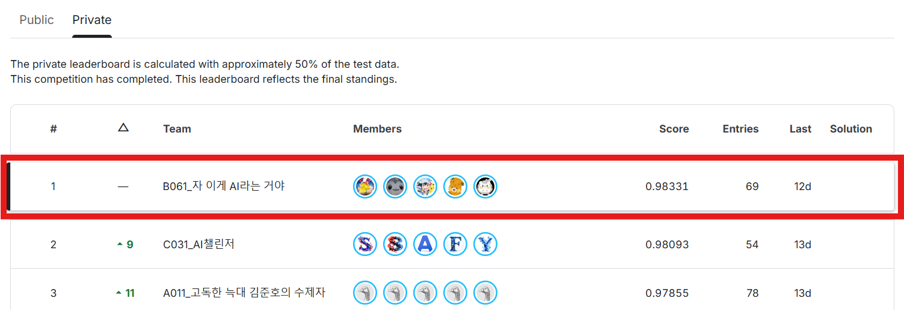
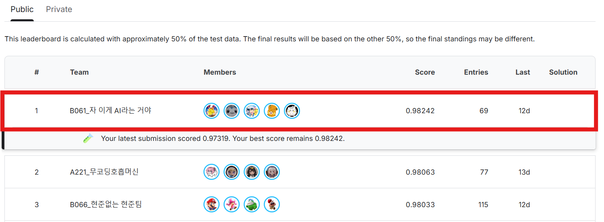
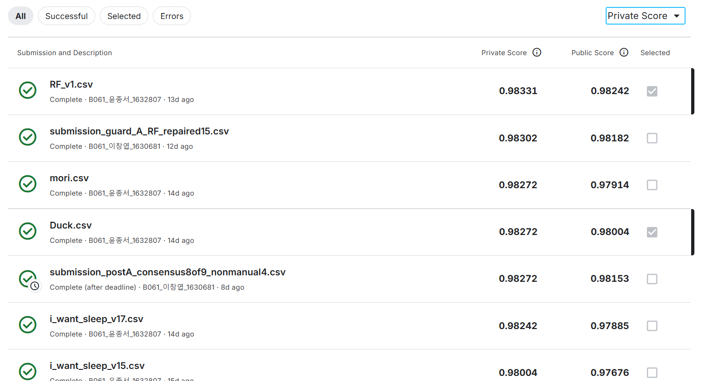
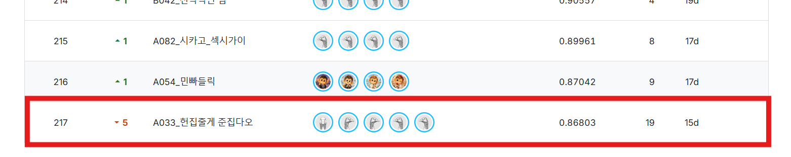
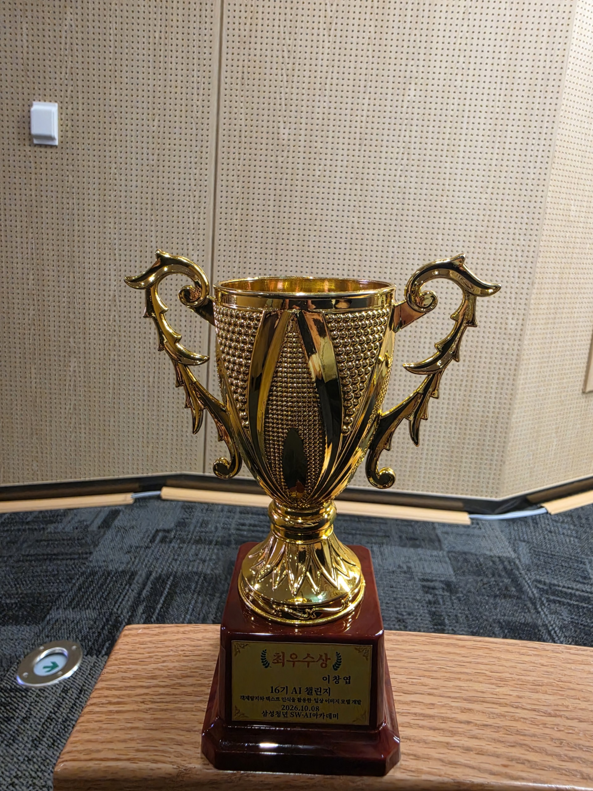

# 실험 설정과 재현 조건

[프로젝트 README](../README.md)

## 1. 최종 성과와 제출물

최종 1위 성적은 선택 제출물 **RF_v1.csv**의 Private **0.98331**, Public **0.98242**입니다.

| 제출물 | Public | Private | 상태 |
| --- | ---: | ---: | --- |
| [RF_v1.csv](../앙상블_결과/RF_v1.csv) | 0.98242 | 0.98331 | 최종 선택 · 1위 성적 |
| [submission_guard_A_RF_repaired15.csv](../앙상블_결과/submission_guard_A_RF_repaired15.csv) | 0.98182 | 0.98302 | RF_v1에서 15개 답 변경 |
| submission_postA_consensus8of9_nonmanual4.csv | 0.98153 | 0.98272 | A에서 4개 추가 변경 · 마감 후 제출 |
| submission_guard_B_core3_plus_RF21.csv | 미확인 | 미확인 | 별도 예비안 |
| Duck.csv | 0.98004 | 0.98272 | 화면상 또 다른 선택 제출물 · 실행 대응 미확인 |

RF_v1과 A는 모두 6,714행이며 ID 순서가 같습니다. 차이는 15개 문항의 답입니다. RF_v1의 저장소 정리본과 solution 패키지 원본은 같은 내용이고, 점수 JSON의 해시와 일치합니다.

```text
RF_v1.csv SHA-256
1b353e8a8e2426d10b078c83cdd43d212c63fd007f5639285b2fb4ac10117dfb
```

원본 `RF_v1_score.json`에는 Public만 기록돼 있습니다. Private와 선택 상태는 제공된 Kaggle 제출 화면으로 연결했습니다. Kaggle 업로드본을 다시 내려받아 바이트 단위로 대조하는 절차는 남아 있습니다.

RF_v1은 확인된 최종 제출 후보 중 최고 성적입니다. 모든 앙상블 조합의 탐색 결과를 뜻하지 않습니다.

### 성과 근거

전체 참가 219팀은 팀 제공 정보입니다. Kaggle 화면의 마지막 순위는 217위이며, 두 집계 기준의 차이는 미확인입니다.

<details>
<summary><strong>Private · Public · 제출 내역 · 수상 사진</strong></summary>

**Private 최종 리더보드 · 1위, 0.98331**



**Public 리더보드 · 1위, 최고 0.98242**



**제출물별 성적과 최종 선택 상태**



**Kaggle 리더보드 하단 · 마지막 순위 217위**



**팀 시상 화면 · 대전6반 ‘이게 AI라는 거야’**


**최우수상 트로피 · 이창엽, 2026.10.08**

<p align="center">
  
</p>

</details>

## 2. 데이터와 평가

### CSV와 이미지 연결

| 항목 | 처리 |
| --- | --- |
| 입력 열 | `id, path, question, a, b, c, d` |
| 정답 | `answer` · a/b/c/d |
| 이미지 | 데이터 루트 + `path` |
| 학습 라벨 인덱스 | a=0, b=1, c=2, d=3 |
| 제출 열 | `id,answer` |
| 제출 순서 | sample submission의 ID 순서 |
| 라벨 출처 | train 원본 정답 / dev AI 시각 pseudo-label 구분 |

### 기존 분할과 후속 분할

| 항목 | 대회 clean7169 | 후속 재사용 베이스 |
| --- | --- | --- |
| 데이터 규모 | train 출처 5,527 + dev 출처 1,642 = 7,169 | 입력 데이터에 따라 결정 |
| 학습/검증 | 5,735 / 1,434 고정 manifest | 이미지 그룹을 고려한 약 4:1 |
| 분할 기준 | 공통 코드의 이미지 SHA-256 그룹 · seed 42 | 이미지 그룹과 고정 seed·manifest |
| 정답 위치 | 기존 보기 순서 | 학습 보기 재배치로 a/b/c/d 약 25%씩 배정 |
| validation/test 보기 | 원래 순서 | 원래 순서 |
| 중복 검사 범위 | 같은 바이트의 이미지 | 그룹 분리 후 중복 검사 |

정답 위치 균등화는 **학습 샘플의 보기와 정답을 함께 재배치**하는 처리입니다. 4:1 분할만으로 정답 위치가 25%씩 되지는 않습니다. SHA-256 중복 검사는 재압축·크롭 등 바이트가 다른 유사 이미지를 별도로 탐지해야 합니다.

### 대표 validation 결과

| 모델 | 전체 평가 | 원본 정답 출처 | dev 출처 |
| --- | --- | --- | --- |
| Qwen3-VL 4B | 1,284/1,343 · 95.6069% | 실행 manifest 참조 | 실행 manifest 참조 |
| Qwen3-VL 8B | 1,364/1,434 · 95.1185% | 실행 manifest 참조 | 실행 manifest 참조 |
| Gemma26 | 1,301/1,343 · 96.8727% | 실행 manifest 참조 | 실행 manifest 참조 |
| Gemma31 | 1,400/1,434 · 97.6290% | 1,118/1,123 · 99.5548% | 282/311 · 90.6752% |

672·1,343·1,434개 평가와 RF의 공식 정답 1,096개 평가는 실행별로 구분합니다. Qwen8B의 별도 공유 수치 97.5957%는 다른 실행의 원본 정답 출처 부분 평가입니다.

**비교 키:** 문항 ID + 이미지 + 보기 순서 + 정답 + 라벨 출처 + split manifest.

데이터 위치: [공통/데이터_위치.md](../공통/데이터_위치.md)  
정제 CSV: [train_combined_clean.csv](../공통/cleaning_data/train_combined_clean.csv)

## 3. 모델 ID와 실행 환경

실행 방식은 보관 코드 기준입니다. Public 성적과 정확한 adapter·run의 연결 상태는 모델별 기록으로 관리합니다.

| 모델·실험 | 실행 모델 ID | 가중치·학습 | 노트북·로그의 환경 |
| --- | --- | --- | --- |
| [Qwen27 Hybrid](../창엽/Qwen3.8-27B_OCR-DINO/) | `btbtyler09/Qwen3.8-27B-GPTQ-4bit` | GPTQ 4bit + LoRA · EasyOCR/DINO | A100 80GB |
| [Qwen27 Only](../창엽/Qwen3.8-27B_Only/) | `btbtyler09/Qwen3.8-27B-GPTQ-4bit` | GPTQ 4bit + attention LoRA | A100 80GB |
| [Qwen122](../창엽/Qwen3.5-122B-A10B-GPTQ-Int4/) | `Qwen/Qwen3.5-122B-A10B-GPTQ-Int4` | GPTQ Int4 · 깡 추론 | vLLM custom wheel |
| [Agnes](../창엽/Agnes-3.0-Flash/) | `Agnes-AI/Agnes-3.0-Flash` | BF16 LoRA | G4 노트북 환경 |
| [GLM](../창엽/GLM-4.6V_AWQ-4bit/) | `cyankiwi/GLM-4.6V-AWQ-4bit` | AWQ 4bit · 깡 추론 | A100/G4 프로필 |
| [Ling](../창엽/Ling-3.0-flash/) | `inclusionAI/Ling-3.0-flash-VL-int4` | INT4 · 깡 추론 | G4 · Ling vLLM fork |
| [Qwen3-VL 4B](../종서/Qwen3-VL-4B-Instruct/) | `Qwen/Qwen3-VL-4B-Instruct` | BF16 LoRA | RTX 5060 Ti |
| [Qwen3-VL 8B](../종서/Qwen3-VL-8B-Instruct/) | `Qwen/Qwen3-VL-8B-Instruct` | BF16 LoRA | A100 |
| [Gemma26](../종서/Gemma-4-26B-A4B-it/) | `google/gemma-4-26B-A4B-it` | BF16 LoRA | G4 노트북 환경 |
| [Gemma31](../종서/Gemma-4-31B-it/) | `google/gemma-4-31B-it` | BF16 LoRA | RTX PRO 6000 Blackwell Server Edition · 평가 로그 |
| [Qwen2.5-VL](../종서/Qwen2.5-VL-7B-Instruct/) | `Qwen/Qwen2.5-VL-7B-Instruct` | LoRA 셀 보관 · 성적 run 미확인 | 개별 노트북·env.md 참조 |

Qwen27 Only는 OCR/DINO를 제외한 경로입니다. 보관 노트북에는 LoRA 학습이 포함돼 있습니다. Qwen/Gemma의 `full` 프로필은 데이터 범위를 뜻하며, 모든 파라미터를 학습한다는 의미로 해석하지 않습니다.

라이브러리·CUDA 설치 순서는 각 모델 폴더의 `env.md`, `requirements.txt`, 노트북 설치 셀에 따릅니다. Qwen122의 custom wheel과 Ling의 fork는 환경을 분리합니다.

### Gemma31 대표 실행

출처: [config.json](../종서/Gemma-4-31B-it/대표_실행/config.json) · [after_metrics.json](../종서/Gemma-4-31B-it/대표_실행/after_metrics.json)

| 항목 | 실제 실행값 |
| --- | --- |
| run ID | `20260925T124050809287Z-gemma4-31b-full-bf16` |
| 모델 | `google/gemma-4-31B-it` |
| dtype / 양자화 | BF16 / none |
| LoRA | r=8 · alpha=16 |
| 학습률 / epoch | 1e-4 / 1 |
| gradient accumulation | 8 |
| seed | 42 |
| context / max soft tokens | 2,048 / 560 |
| thinking | false |
| loss mode | `gemma4_answer_positions_v1` |
| validation | 1,400/1,434 · 실패 0 |
| 평가 메모리 | allocated 59.316GB · reserved 59.479GB |
| 메모리 측정 범위 | 평가 단계 PyTorch allocator |
| 출력 경로 | `/content/drive/MyDrive/mori/training_runs/gemma4_31b_clean7169` |

실제 학습 batch와 전체 학습 시점 VRAM은 위 로그의 확인 범위 밖입니다. 재현 설정은 현재 노트북 기본값보다 저장된 run config를 우선합니다.

### 깡 실행과 파인튜닝

| 단계 | 깡 실행 | 파인튜닝 |
| --- | --- | --- |
| 모델 로드 | 사전학습 가중치 | 사전학습 가중치 + LoRA |
| 학습 샘플 | 추론 입력 구성 | 이미지·질문·보기·정답으로 학습 샘플 구성 |
| 최적화 | 없음 | 지정 loss·optimizer·학습률·배치로 학습 |
| 체크포인트 | 모델 snapshot | 모델 snapshot + 선택 adapter |
| 추론 | 프롬프트·이미지 입력 | 동일 입력 + 학습 adapter 적용 |
| 출력 | 생성 답 또는 실제 choice logits/probs | 생성 답 또는 실제 choice logits/probs |
| 평가 | 고정 validation·test | 고정 validation·test |

### Agnes 추론

1024 고해상도 입력에서 shift 0/1/2/3을 추론합니다.

| shift | 입력에 놓는 원래 보기 |
| --- | --- |
| 0 | a · b · c · d |
| 1 | b · c · d · a |
| 2 | c · d · a · b |
| 3 | d · a · b · c |

추론 순서는 **답 위치의 4개 logits → Softmax → 원래 보기 열로 복원 → 확률 평균**입니다. 이 shift는 보기 순환 이동입니다.

## 4. 앙상블

### Hard / Soft 원본

| 태그 | validation 1,434개 실제 soft | test 6,714개 실제 soft |
| --- | --- | --- |
| qwen27_new | 확보 | 확보 |
| agnes | 확보 | 확보 |
| qwen_og | 미확인 | 확보 |
| qwen4 / qwen8 / gemma26 / gemma31 / qwen122 / ling | 미확인 | 미확인 |

확률 파일의 저장소 포함 여부와 checkpoint 연결 상태는 [확률 원본 상태](../앙상블_결과/확률_원본_상태.md)를 기준으로 관리합니다. `qwen27_new`와 `qwen_og`의 정확한 checkpoint 차이는 미확인입니다.

Soft 결합은 실제 확률이 있는 모델을 대상으로 합니다. Hard one-hot은 별도 투표 특징으로 표시합니다. ID를 기준으로 행을 맞추고, 확률 열은 원래 보기 `[a,b,c,d]`로 정렬합니다.

### 기존 RF 구성

원본: [ensemble_rf](<../공통/B061_자_이게_AI라는거야_solution/B061_자 이게 AI라는 거야_solution/ensemble_rf/>)

| 항목 | 내용 |
| --- | --- |
| 학습 단위 | 문항당 a/b/c/d 후보 4개 |
| target | 해당 후보가 정답이면 1, 나머지 0 |
| 특징 | 4모델 후보 지지, 경쟁 보기 득표, 득표 차이, 의견 분산, 질문 유형 |
| 교차 검증 | 이미지 해시 GroupKFold 5 · 같은 문항의 후보는 같은 fold |
| n_estimators | 300 |
| min_samples_leaf / max_depth | 12 / 8 |
| max_features / n_jobs / random_state | 0.8 / 4 / 42 |
| 검증 결과 | RF 1,091/1,096 · 최고 단일 모델 1,091/1,096 |

최종 RF_v1 제작에는 RF 추정 외에 보조 추정, 60개 기존 제출의 점수 조건, projection·max entropy·조건부 최적화가 포함됩니다. 최종 Public 향상 폭은 이 전체 제출 과정의 결과입니다.

실행 패키지에는 `research.py`, `rf_validation.json`, `RF_v1_score.json`, `results_and_change_rationale.md`와 생성·검증 코드가 보관돼 있습니다. 일부 생성 단계는 Node 런타임과 artifact 도구 의존성을 사용합니다.

### 후보 발전 과정

| 순서 | 실험 |
| --- | --- |
| 1 | Gemma31을 기준 답으로 모델 불일치 분석 |
| 2 | Hard 투표 · 4/8모델 만장일치 · core 합의 비교 |
| 3 | 확보된 실제 Soft의 평균·가중 결합 |
| 4 | RF 학습과 점수 조건을 결합한 RF_v1 제작 |
| 5 | 18문항 수동 검토 · RF_v1에서 15개 변경한 A 제작 |
| 6 | B 예비안 · A에서 4개 추가 변경한 postA 비교 |
| 7 | 최종 선택 RF_v1의 Private 0.98331 확인 |

[수동 검토 18문항](../앙상블_결과/manual18_image_audit.csv)은 검토 판단 자료입니다. 공식 정답으로 취급하지 않습니다. [Private 방어 감사](../앙상블_결과/RF_private_defense_audit.md)는 Private 공개 전의 판단 기록입니다.

Public 집계 점수만으로 개별 문항의 정답이나 공개 구간 포함 여부를 일반적으로 확정할 수 없습니다. 제출 점수를 조건으로 사용한 결론은 채점 가정에 따릅니다. 후속 베이스는 validation·메타 holdout·OOF를 구분해 후보를 평가합니다.

## 5. 후속 재사용 베이스

대회 Gemma31 실행과 후속 Unsloth 프리셋은 서로 다른 설정입니다.

| 항목 | 대회 Gemma31 | 후속 베이스 |
| --- | --- | --- |
| 모델 | google Gemma4 31B | Unsloth Gemma4 31B bnb4bit |
| 가중치 | BF16 · 비양자화 | bitsandbytes 4bit |
| LoRA | r=8 · alpha=16 | r=16 · alpha=32 · language attention + MLP |
| 학습 | 대회 정제 데이터 1 epoch | 외부 → 내부, 각 1 epoch |
| 검증 상태 | 대표 학습·평가 로그 보관 | CPU 점검 완료 · 전체 GPU 성적 미측정 |

### 단계와 초기값

| 단계 | 기본 설정 |
| --- | --- |
| 외부 데이터 | MTVQA 한국어를 4지선다로 변환, KRETA 객관식 사용 |
| Stage 1 | 외부 데이터 · 1 epoch · 학습률 1e-4 · 증강 없음 |
| Stage 2 | 내부 정제 데이터 · 1 epoch · 학습률 1e-4 |
| stage 연결 | 동일 adapter 이어 학습 · stage별 optimizer 초기화 |
| loss | 정답 글자 1토큰 위치의 전체 어휘 Cross-Entropy |
| 프롬프트 | 질문·보기·출력 지시 2회 반복 · 이미지 1회 |
| 이미지 기본 | 비율 유지 cap 2,048 · max soft tokens 1,120 |
| 내부 증강 | 원본 + JPEG quality 70 + Gaussian blur radius 1.0 + affine |
| affine | 이동 ±3% · 기울임 ±5° |
| 추론 | 4 choice logits · Softmax T=1 · shift 0/2 확률 평균 |
| 선택 처리 | OCR/DINO · 1024 letterbox · 4-way TTA · 어려운 문항 보기 반전 |
| 기본 모드 | prepare |
| 앙상블 학습 옵션 | RF·학습 가중치·확률 보정 기본 비활성 |

어려운 문항 검토와 추가 증강은 선택 처리입니다. Public 0.97229 솔루션의 라벨 정제·외부 데이터 방식은 [Reference Integration](../baseline_v2+ensemble_v1/VQA_Reference_Integration.md)에 코드·글 차이와 함께 정리돼 있습니다. 외부 데이터 단계는 적용할 대회의 허용 범위에 맞춰 활성화합니다.

### run 출력 규격

N은 해당 run의 실제 manifest 문항 수입니다.

| 파일 | 의미 |
| --- | --- |
| `probs/valid_logits.npy` | `(N_valid,4)` · reference shift 0의 실제 logits |
| `probs/valid_probs.npy` | `(N_valid,4)` · 순서 복원 후 TTA 평균 확률 |
| `probs/valid_labels.npy` | `(N_valid,)` · a/b/c/d = 0/1/2/3 |
| `probs/valid_ids.json` | validation 행 ID |
| `probs/test_logits.npy` | `(N_test,4)` · reference shift 0의 실제 logits |
| `probs/test_probs.npy` | `(N_test,4)` · 순서 복원 후 TTA 평균 확률 |
| `probs/test_ids.json` | test 행 ID |
| `probs/probability_metadata.json` | 모델·adapter·분할·클래스·shift·집계 방식 |
| `validation_predictions.csv` | 문항별 예측과 정답 |
| `validation_summary.json` | 평가 범위·지표 |
| `analysis/shift_calibration.csv` | shift별 validation 평가 |
| `analysis/selected_shift.json` | 적용 shift 레시피 |
| 제출 CSV | sample submission ID 순서의 `id,answer` |

TTA 평균 확률은 `softmax(reference_logits)`와 다를 수 있습니다. 평균 확률의 로그는 원시 logits와 별도로 취급합니다.

앙상블 노트북은 저장된 모델 결과를 입력받습니다. 메타 학습을 활성화하면 meta-fit/meta-holdout과 내부 OOF로 검증합니다. 새 RF 옵션은 기존 RF_v1을 재현한 구현과 구분합니다.

## 6. 재현 조건

| 항목 | 실행 조건·남은 확인 사항 |
| --- | --- |
| 원본 이미지 | 저장소 외부 데이터 위치에서 확보 |
| 모델·adapter | 정확한 snapshot·adapter·config를 준비 |
| 환경 | 모델별 설치 셀·env.md·requirements.txt 사용 |
| Qwen27 | 공유 Public와 정확한 checkpoint·추론 run 연결 추가 확인 |
| Qwen2.5-VL | Public 0.89603의 제출 CSV·run 연결 미확인 |
| Soft 원본 | 일부 외부 보관 · 다른 모델의 공통 validation Soft 미확인 |
| B | 정확한 제출 점수 미확인 |
| 후속 베이스 | 전체 GPU 학습·추론·리더보드 검증 전 |

**원본 Gemma31 설정 셀:** `learning_rate=5e-5,,`의 중복 쉼표를 수정해야 합니다. 성적 재현 시 학습률은 대표 run의 `1e-4`를 적용합니다.

**재현에 함께 고정할 정보:** 모델 revision, adapter, 데이터 해시, split manifest, 프롬프트, 이미지 processor, 클래스 순서, shift 레시피, 라이브러리·GPU 환경.

## 7. 관련 자료

| 자료 | 용도 |
| --- | --- |
| [파일 대응표](../파일_대응표.csv) | 모델·노트북·제출 CSV 연결 |
| [팀 공통 베이스라인](../공통/팀_공통_베이스라인.ipynb) | 공통 데이터·학습·평가 구조 |
| [종서 실험 기록](../종서/실험_기록/) | 대표 run과 개별 validation 기록 |
| [24단계 체크리스트](../baseline_v2+ensemble_v1/VQA_Baseline_Checklist.md) | 환경 → 데이터 → 학습 → 추론 → 제출 |
| [모델 코드 설명](../baseline_v2+ensemble_v1/VQA_Model_Pipeline_Code_Guide.md) | 단계별 코드·설정 |
| [앙상블 코드 설명](../baseline_v2+ensemble_v1/VQA_Ensemble_Pipeline_Code_Guide.md) | ID 정렬·Hard/Soft·RF·평가 |
